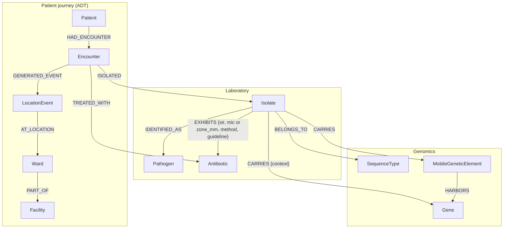

# The BioNexus knowledge graph: a developer guide

This guide is for developers who are new to knowledge graphs, to AMR
(antimicrobial resistance) surveillance, or to both. It explains what is
in the graph, which way every relationship points and why, and how to
query and extend it. Every query here runs against the published demo
graph in this folder; the results quoted are from that graph.

- [1. Graphs in five minutes](#1-graphs-in-five-minutes)
- [2. The model](#2-the-model)
- [3. Nodes](#3-nodes)
- [4. Relationships and their direction](#4-relationships-and-their-direction)
- [5. Design decisions](#5-design-decisions)
- [6. Query cookbook](#6-query-cookbook)
- [7. AMR terms a developer meets in this graph](#7-amr-terms-a-developer-meets-in-this-graph)
- [8. Extending the model](#8-extending-the-model)
- [9. Known limitations](#9-known-limitations)

## 1. Graphs in five minutes

A Neo4j graph has three building blocks:

- **Nodes** are things: a patient, an isolate, an antibiotic. Each node has
  one or more **labels** (`:Patient`), which work like table names.
- **Relationships** connect two nodes. Each has a **type**
  (`:HAD_ENCOUNTER`) and always a **direction**, from a start node to an
  end node.
- **Properties** are key–value pairs on nodes and relationships, such as
  `{sir: 'R', mic: 8.0}` on a susceptibility result.

Cypher, Neo4j's query language, draws these as ASCII art. `(i:Isolate)` is
a node, and `-[:EXHIBITS]->` is a relationship with its direction:

```cypher
MATCH (i:Isolate)-[r:EXHIBITS]->(a:Antibiotic {name: 'Meropenem'})
WHERE r.sir = 'R'
RETURN i.id, r.mic
```

Direction is fixed when a relationship is stored, but a query may follow it
either way: `(a)<-[:EXHIBITS]-(i)` and `(i)-[:EXHIBITS]-(a)` (no arrow)
match the same relationships. So the model stores every fact **once**, in
the direction that reads naturally. It never stores a reverse copy.

## 2. The model

Arrows show the stored direction. Read each one as a sentence: a patient
*had* an encounter; an isolate *exhibits* a result against an antibiotic.



The demo graph holds 3,373 nodes and 13,092 relationships. Three groups of
nodes do different jobs:

- **Event records:** Patient, Encounter, LocationEvent and Isolate are
  facts about one person and one admission. They change with every load.
- **Places:** Ward and Facility are the hospital structure.
- **Reference vocabulary:** Pathogen, Antibiotic, SequenceType and Gene are
  shared reference nodes, one per real-world concept. Each carries an
  external identifier, so two hospitals that report "K. pneumoniae" and
  "Klebsiella pneumoniae" end up on the same node.

## 3. Nodes

Every label has a uniqueness constraint on its key (see
`backend/bionexus/schema.py`). The loader writes with `MERGE` on that key,
so reloading a file never creates duplicates.

| Label | Key | Other properties | What it is | Demo count |
|---|---|---|---|---|
| Patient | `id` | `sex` | A person. With pseudonymisation on, `id` is a keyed hash (`P-…`) | 600 |
| Encounter | `id` | `admitted`, `discharged`, `age_years` or `age_band` | One hospital admission | 606 |
| LocationEvent | `id` | `timestamp`, `source` (`adt` or `specimen_collection`) | The patient was in a ward at a moment in time | 1,320 |
| Ward | `key` (`FACILITY:Ward name`) | `name` | A ward; names repeat across hospitals, so the key includes the facility | 17 |
| Facility | `code` | `name`, `province` | A hospital | 4 |
| Isolate | `id` | `collected`, `specimen`, `screening`, `origin`, `hospital_day`, `phenotype_labels`, `genotype_status` | One organism grown from one specimen | 673 |
| Pathogen | `ncbi_taxid` | `species`, `genus` | A species, keyed by [NCBI Taxonomy](https://www.ncbi.nlm.nih.gov/taxonomy) ID | 7 |
| Antibiotic | `atc_code` | `name`, `aware` | An antimicrobial, keyed by WHO ATC code, with its WHO AWaRe group | 24 |
| SequenceType | `key` (`scheme:STn`) | `scheme`, `st_number` | An MLST sequence type ([PubMLST](https://pubmlst.org/)) | 31 |
| Gene | `aro_id` | `symbol`, `name`, `category`, `mechanism`, `acquired` | A resistance gene variant, keyed by [CARD ARO](https://card.mcmaster.ca/) accession | 14 |
| MobileGeneticElement | `key` | `type` (plasmid, integron, transposon), `replicon` | One plasmid, transposon or integron in one isolate | 77 |

`screening` marks colonisation screens such as a rectal CPE swab: they
count for outbreak detection but not for resistance rates. `origin` is
`hospital` or `community` by the WHO GLASS rule (more than 2 calendar days
in hospital at sampling), derived after each ingest; `hospital_day` is the
day of the admission on which the specimen was taken.

`genotype_status` distinguishes three states that are easy to confuse:
`not_sequenced`, `no_determinant_detected` (sequenced, nothing found) and
`determinants_detected`.

## 4. Relationships and their direction

The rule: **an arrow runs from the record that owns or produces something
to the thing it points at.** Event records point at places and at
reference vocabulary. Reference nodes never point back.

| Pattern | Meaning | Cardinality in the demo | Properties | Count |
|---|---|---|---|---|
| `(Patient)-[:HAD_ENCOUNTER]->(Encounter)` | One admission of that patient | 1 patient : 1–2 encounters | – | 606 |
| `(Encounter)-[:GENERATED_EVENT]->(LocationEvent)` | An admission, transfer or specimen-collection event | 1 encounter : 1–4 events | – | 1,320 |
| `(LocationEvent)-[:AT_LOCATION]->(Ward)` | Where the patient was at that moment | each event : 1 ward | – | 1,320 |
| `(Ward)-[:PART_OF]->(Facility)` | Ward belongs to a hospital | each ward : 1 facility | – | 17 |
| `(Encounter)-[:ISOLATED]->(Isolate)` | Culture grown from a specimen taken in that admission | 1 encounter : 1–2 isolates | – | 673 |
| `(Isolate)-[:IDENTIFIED_AS]->(Pathogen)` | Species identification | each isolate : 1 species | – | 673 |
| `(Isolate)-[:EXHIBITS]->(Antibiotic)` | One susceptibility (AST) result | 1 isolate : 3–16 results | `sir`, `method`, `mic`, `mic_qualifier`, `mic_unit`, `zone_mm`, `guideline` | 7,391 |
| `(Encounter)-[:TREATED_WITH]->(Antibiotic)` | Antibiotic prescribed in that admission | 1 encounter : 0–2 agents | – | 594 |
| `(Isolate)-[:BELONGS_TO]->(SequenceType)` | MLST sequence type from sequencing | sequenced isolate : 1 ST | `clone_designation` (e.g. USA300) when named | 197 |
| `(Isolate)-[:CARRIES]->(Gene)` | Acquired gene not placed on a mobile element | 1 isolate : 1–2 genes | `context` | 147 |
| `(Isolate)-[:CARRIES]->(MobileGeneticElement)` | That isolate's own mobile element | each element : 1 isolate | – | 77 |
| `(MobileGeneticElement)-[:HARBORS]->(Gene)` | Gene located on that element | each element : 1 gene | – | 77 |

`EXHIBITS` holds exactly one measurement: either `mic` (mg/L, with
`mic_qualifier` such as `<=` or `>`) when `method = 'MIC'`, or `zone_mm`
when `method = 'DISK'`. `sir` is the category (S, I, SDD or R), and
`guideline` names the breakpoint table used to interpret it, such as
`CLSI 2026`.

## 5. Design decisions

**Admissions and movements are event nodes, not relationship properties.**
A patient's ward changes over time, so "which ward?" only has an answer at a
given moment. Each move is a `LocationEvent` node with a timestamp, and an
isolate's ward is *derived*: it is the ward of its encounter's latest
LocationEvent at or before collection. This follows Neo4j's guidance to
model events with their own properties and connections as nodes
([Neo4j modeling designs](https://neo4j.com/docs/getting-started/current/data-modeling/modeling-designs/)).

**Results live on the relationship.** A susceptibility result connects one
isolate to one antibiotic and belongs to neither, so its values sit on
`EXHIBITS`. If drug-centred queries over millions of results slow down,
the next step is to promote results to `:AstResult` nodes.

**Mobile elements are per isolate.** A single shared `IncX3` node would
connect every isolate carrying any IncX3 plasmid and imply plasmid
transmission the data cannot show: replicon type alone does not identify a
plasmid. Cross-species gene spread is therefore a computed signal (same
CARD gene variant in several species), not a stored edge.

**Derived results are not stored.** Clusters, gene-transfer signals and
ward rankings are computed on demand. That keeps the graph a record of
observations, and lets analysts change the window or thresholds without
reloading. The ward network for PageRank exists only as a Graph Data
Science in-memory projection.

**Lab shorthand is split from taxonomy.** A laboratory reports
"Klebsiella pneumoniae (CRE)". The species goes to `Pathogen` by NCBI
Taxonomy ID, and `CRE` goes to `Isolate.phenotype_labels`, because CRE is a
property of this isolate, not of the species.

**Supernodes to watch.** Reference nodes collect many relationships: in the
demo one Antibiotic node receives 631 `EXHIBITS`. That is fine at hospital
scale. At national scale, filter from the isolate side or add a
relationship-property index on `EXHIBITS.sir` before running drug-centred
queries.

## 6. Query cookbook

Load the graph first (see [README.md](README.md)), then try these in Neo4j
Browser.

**Where was the patient when the specimen was taken?** Result: Neonatal ICU
at WTH.

```cypher
MATCH (e:Encounter)-[:ISOLATED]->(i:Isolate {id: 'LAB25-100215'})
MATCH (e)-[:GENERATED_EVENT]->(le:LocationEvent)-[:AT_LOCATION]->(w:Ward)-[:PART_OF]->(f:Facility)
WHERE le.timestamp <= i.collected
RETURN w.name AS ward, f.code AS facility
ORDER BY le.timestamp DESC LIMIT 1
```

**Is a gene moving between species?** Result: blaNDM-5 on IncX3 in
*E. coli* (4), *K. pneumoniae* (3) and *E. cloacae* (2).

```cypher
MATCH (g:Gene {symbol: 'blaNDM-5'})<-[:HARBORS]-(m:MobileGeneticElement)
      <-[:CARRIES]-(i:Isolate)-[:IDENTIFIED_AS]->(p:Pathogen)
RETURN p.species AS species, m.replicon AS replicon, count(i) AS isolates
```

**Was the patient on an antibiotic their isolate resists?** Result:
meropenem (42 isolates), piperacillin-tazobactam (41), ceftriaxone (31).

```cypher
MATCH (e:Encounter)-[:TREATED_WITH]->(a:Antibiotic)<-[:EXHIBITS {sir: 'R'}]-(i:Isolate)<-[:ISOLATED]-(e)
RETURN a.name AS drug, a.aware AS aware, count(DISTINCT i) AS isolates
ORDER BY isolates DESC
```

**Which wards feed which?** Result: Medical → Adult ICU leads at GAH (10),
WTH (9) and KRH (7).

```cypher
MATCH (e:Encounter)-[:GENERATED_EVENT]->(le:LocationEvent {source: 'adt'})-[:AT_LOCATION]->(w:Ward)
WITH e, w ORDER BY le.timestamp
WITH e, collect(w) AS path
UNWIND range(0, size(path) - 2) AS k
WITH path[k] AS a, path[k + 1] AS b WHERE a <> b
RETURN a.key AS from_ward, b.key AS to_ward, count(*) AS transfers
ORDER BY transfers DESC
```

**Hospital- or community-origin?** WHO GLASS counts an isolate as
hospital-origin when the patient had been in hospital more than 2 calendar
days. The loader stores the answer as `Isolate.origin`; this query shows the
rule itself. Result: 52 of 59 CRE *K. pneumoniae* isolates are
hospital-origin.

```cypher
MATCH (e:Encounter)-[:ISOLATED]->(i:Isolate)-[:IDENTIFIED_AS]->(:Pathogen {species: 'Klebsiella pneumoniae'})
WHERE 'CRE' IN i.phenotype_labels AND e.admitted IS NOT NULL
WITH i, duration.inDays(date(e.admitted), date(i.collected)).days + 1 AS hospital_day
RETURN CASE WHEN hospital_day > 2 THEN 'hospital origin' ELSE 'community origin' END AS origin, count(*) AS isolates
```

**First isolate per patient and species** (the CLSI M39 rule for
antibiograms), leaving out screening swabs. `bionexus resistance` computes
the same for every priority phenotype. Result: CRE in 25% of
*K. pneumoniae*, 17% of *E. cloacae* and 7% of *E. coli* patients.

```cypher
MATCH (p:Patient)-[:HAD_ENCOUNTER]->(:Encounter)-[:ISOLATED]->(i:Isolate)-[:IDENTIFIED_AS]->(g:Pathogen)
WHERE g.genus IN ['Klebsiella', 'Escherichia', 'Enterobacter']
  AND NOT i.screening
WITH g, p, i ORDER BY i.collected
WITH g, p, collect(i)[0] AS first
RETURN g.species AS species, count(*) AS patients,
       round(100.0 * sum(CASE WHEN 'CRE' IN first.phenotype_labels THEN 1 ELSE 0 END) / count(*)) AS cre_percent
ORDER BY species
```

The heavier analytics (outbreak clusters, gene-transfer signals, GDS ward
ranking, alerts, stewardship) are in `backend/bionexus/analytics.py` and
`alerts.py`, and run through the CLI (`bionexus clusters`, `hgt`, `wards`,
`alerts`, `stewardship`) or the REST API.

## 7. AMR terms a developer meets in this graph

| Term | Meaning | Where it appears |
|---|---|---|
| Isolate | One organism grown from one patient specimen | `:Isolate` |
| AST | Antimicrobial susceptibility testing: does the antibiotic stop this isolate growing? | `EXHIBITS` |
| MIC | Minimum inhibitory concentration, the lowest antibiotic concentration that stops growth (mg/L); higher means more resistant | `EXHIBITS.mic` |
| Disk diffusion zone | Diameter of the no-growth ring around an antibiotic disk (mm); smaller means more resistant | `EXHIBITS.zone_mm` |
| Breakpoint | The MIC or zone cut-off that turns a measurement into a category. Published yearly by CLSI and EUCAST | `bionexus/breakpoints.py` |
| S / I / SDD / R | Susceptible, intermediate, susceptible-dose-dependent, resistant | `EXHIBITS.sir` |
| CRE, CRAB, CRPA | Carbapenem-resistant Enterobacterales, *A. baumannii*, *P. aeruginosa* | `Isolate.phenotype_labels` |
| 3GC-R | Third-generation-cephalosporin-resistant Enterobacterales (WHO Critical priority); usually an ESBL producer | outbreak phenotypes, resistance rates |
| MRSA, VRE, ESBL | Methicillin-resistant *S. aureus*, vancomycin-resistant enterococci, extended-spectrum beta-lactamase producer | `Isolate.phenotype_labels` |
| Carbapenemase | An enzyme that destroys carbapenems, e.g. OXA-48-like, NDM, KPC | `Gene.category` |
| MLST / sequence type (ST) | A coarse strain type from seven housekeeping genes; ST307 is a high-risk *K. pneumoniae* clone | `:SequenceType` |
| Plasmid, replicon | A plasmid is a mobile DNA circle that can move between bacteria; its replicon type (e.g. IncX3) is a family label, not an identity | `:MobileGeneticElement` |
| ARO | CARD's Antibiotic Resistance Ontology, the identifiers for resistance genes | `Gene.aro_id` |
| ATC | WHO Anatomical Therapeutic Chemical code for a drug | `Antibiotic.atc_code` |
| AWaRe | WHO grouping of antibiotics into Access, Watch and Reserve for stewardship | `Antibiotic.aware` |
| GLASS | WHO's Global Antimicrobial Resistance and Use Surveillance System, to which countries report | analytics, not stored |
| First-isolate rule | Count each patient's first isolate of a species once per period (CLSI M39), so repeat cultures do not skew rates | analytics, not stored |

## 8. Extending the model

Adding a node or relationship touches four places:

1. **Constraint:** add the label's key to `CONSTRAINTS` in
   `backend/bionexus/schema.py`. Every label needs one; the graph export
   relies on it.
2. **Validation:** add or extend the Pydantic model in
   `backend/bionexus/models.py`, so bad input is rejected with a line number
   before it reaches the graph.
3. **Write:** add the `MERGE` to `backend/bionexus/loader.py`. Always
   `MERGE` on the constrained key, then `SET` the other properties, so
   reloads stay idempotent.
4. **Tests:** cover it in `backend/tests/test_integration.py`, then
   regenerate the published graph (see [README.md](README.md#regenerate)).

Choose the direction so the pattern reads as a sentence from the record to
what it refers to, and never add the reverse relationship as well. For
example, the recommended genomic-distance link would be:

```cypher
// one relationship per pair, stored once; query it without an arrow
MERGE (a:Isolate {id: $a})-[s:SIMILAR_TO]->(b:Isolate {id: $b})
SET s.snp_distance = $distance, s.method = $method
// ...
MATCH (i:Isolate {id: $id})-[s:SIMILAR_TO]-(other) WHERE s.snp_distance <= 21 RETURN other
```

## 9. Known limitations

The model is sound for hospital-level surveillance, but its genomic layer
is screening-grade:

- Outbreak clusters use a shared sequence type, which is coarser than the
  SNP or core-genome distances used to confirm transmission.
- Plasmids are typed by replicon only.
- Gene calls carry no tool or database version, and point mutations are
  not represented.
- Prescriptions have no dates or doses.
- Only positive cultures are loaded, so GLASS denominators cannot be
  computed.

The full review against WHO, CLSI and South African guidance, with ranked
recommendations, is in the *BioNexus AMR Knowledge Graph Review* shared
with this repository's owner.
